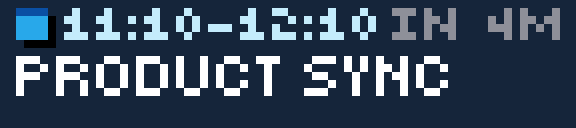
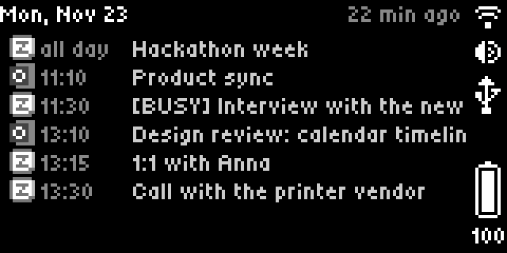

# iCal Calendar for the BUSY Bar

Your week from up to three iCal links on one timeline, with a loud warning before each meeting. The bar reads the calendars itself over its own Wi-Fi: no account to sign in to, no computer, no server in between.





Works with Outlook and Microsoft 365, Google Calendar, iCloud, Proton, Fastmail, Nextcloud and any other service that gives an iCal (.ics) link. Up to three calendars show together as one.

The front display is a timeline of the days ahead, with the current time as a red line. The back display lists the day's meetings. A few minutes before a meeting the bar warns you: the display lights up, the LED blinks and a sound plays. If nobody dismisses it, it warns once more when the meeting begins.

## How to use

- **Scroll Wheel**: moves along the timeline. After 30 seconds without a key it returns to now.
- **OK** or **Start**: dismisses a warning; opens the meeting under the marker.
- **Back**: closes the meeting, then returns to now, then closes the app.
- **Hold OK**: checks the calendars now.

## Setup

1. Find your calendar's iCal link: see below.
2. Open the BUSY Bar's web interface, go to **Apps, iCal Calendar**, and paste the link into **Calendar 1**. Two more calendars go into **Calendar 2** and **Calendar 3**.
3. Start the app on the bar.

To try it without a link, type `demo` instead: a made-up week around the current time, no network needed.

## Settings

For each of the three calendars:

- **iCal link**: the calendar's secret or public iCal (.ics) link; `webcal://` works too.
- **Name on screen**: a short name, e.g. Work. Empty: the service's name.
- **Alerts**: warn before this calendar's meetings.

For all calendars:

- **Warn before**: off, or 1, 2, 5 (default), 10 or 15 minutes.
- **Warn again at the start**: if nobody dismissed the first warning, warn once more when the meeting begins.
- **Sound**: play a sound with each warning.
- **All-day events**: show them. They never warn.
- **Check calendars every**: 5, 10 (default), 15 or 30 minutes.

The app reads its settings when it starts: after a change, close it and start it again.

## Calendar links: where to find them

The app reads a calendar from its iCal (.ics) link: a private address the calendar service gives you. Paste it into the app's settings in the BUSY Bar's web page (Apps, iCal Calendar). Anyone who has the link can read the calendar, so treat it like a password; every service lets you reset it.

**Outlook, work or school (Microsoft 365).** Outlook on the web, Settings, Calendar, Shared calendars, Publish a calendar. Pick the calendar and "Can view all details", Publish, then copy the ICS link. No Publish section: your administrator turned publishing off.

**Outlook.com (personal).** The same steps at outlook.live.com.

**Google Calendar.** calendar.google.com on a computer, Settings, your calendar under "Settings for my calendars", Integrate calendar, then copy "Secret address in iCal format". In a Google Workspace account your administrator may hide it.

**iCloud (Apple Calendar).** On iPhone: Calendar, Calendars, the (i) next to the calendar, turn on Public Calendar, Share Link, Copy. Or on icloud.com/calendar: the share button next to the calendar, Public Calendar, Copy Link. A webcal:// link works as it is.

**Proton Calendar** (paid plans). calendar.proton.me, Settings, Calendars, the calendar, Share with anyone, Create link with Full view, copy it. Proton says changes can take up to 8 hours to reach the link.

**Fastmail.** Settings, Calendars, Edit next to the calendar, Publish with Full event details, copy the iCal link.

**Nextcloud.** Calendar, the menu next to the calendar, Share link, Copy subscription link (it ends with ?export).

**Anything else** (Zoho, Yahoo, Teamup and others): look for a link called iCal, ICS or "subscribe". Notion Calendar and Calendly have none of their own: use the link of the Google or Outlook calendar they are connected to.

Changes reach the bar with a delay: the app checks every 10 minutes (adjustable), and each service refreshes its link on its own schedule.

## Good to know

- The link opens your whole calendar to anyone who has it: treat it like a password. It stays in the bar's settings.
- Set the bar's time zone, or meeting times show in UTC.
- A BUSY session closes every app, this one too: during it there are no warnings.
- Needs firmware 1.4.1 or newer.
- Microsoft 365 links: firmware 1.4.1 loses the last few kilobytes of their answer. The app keeps every meeting up to the last one that arrived whole, so the meetings furthest ahead may be missing until the firmware is fixed.

## Build and install

Node.js 24.

```sh
npm ci
npm test
npm run build         # dist/app.mrlunev.ical_calendar.tgz
npm run app:install   # on a BUSY Bar connected over USB
```

Or open the folder in BUSY Bar Emulator.

A tag equal to the version in `src/appmeta/manifest.json` (e.g. `0.1.0`) builds the app and attaches the package to a GitHub release.

## License

MIT: see [LICENSE](LICENSE). Outlook, Microsoft 365, Google Calendar, iCloud, Proton and Fastmail are trademarks of their owners; this app is not made or endorsed by them.

Made for [BUSY Bar](https://busy.app).
